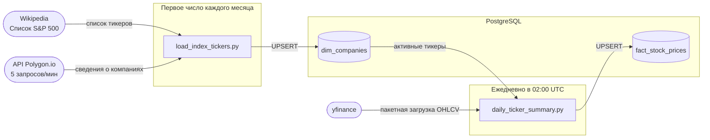

# Пайплайн рыночных данных

Автоматизированный пайплайн для сбора и хранения рыночных данных компаний S&P 500, построенный на Apache Airflow, PostgreSQL и Docker.

## Обзор

Пайплайн выполняет два процесса по расписанию:

- **Ежедневный** - загружает котировки OHLCV для всех компаний S&P 500 через yfinance и сохраняет их в таблицу фактов.
- **Ежемесячный** - получает сведения о компаниях (название, отрасль, биржа, рыночная капитализация, адрес) через API Polygon.io и поддерживает актуальность таблицы измерений, автоматически деактивируя тикеры компаний, покинувших индекс.

## Архитектура



Данные организованы в простую схему «звезда»:

| Таблица | Описание |
|---|---|
| `market_data.dim_companies` | Сведения о компаниях: одна строка на тикер |
| `market_data.fact_stock_prices` | Ежедневные котировки OHLCV: одна строка на тикер и дату |

Обе таблицы поддерживают UPSERT - повторный запуск любого DAG безопасен и не создаёт дубликатов.

## Архитектурные решения

**Два источника данных для двух разных задач.** Polygon.io используется для получения сведений о компаниях: он предоставляет точные данные на лицензионных условиях. Ограничение в 5 запросов в минуту применяется намеренно, чтобы смоделировать типичную проблему реальных пайплайнов: bottleneck. Для истории котировок используется yfinance: загрузка данных OHLCV для всех компаний S&P 500 за год потребовала бы 500 × 365 = 182 500 вызовов API Polygon.io, что невозможно на бесплатном тарифе. yfinance поддерживает пакетную загрузку и позволяет получить всю историю небольшим числом запросов. Неофициальный характер yfinance - известное ограничение, допустимое для проекта в портфолио.

**UPSERT вместо добавления строк без проверки конфликтов.** Оба скрипта используют `INSERT ... ON CONFLICT DO UPDATE/NOTHING`, что делает каждый запуск DAG идемпотентным.

## Стек

- **Оркестрация** - Apache Airflow 3.
- **Хранение** - PostgreSQL 15.
- **Данные** - yfinance, Polygon.io (SDK `massive`).
- **Инфраструктура** - Docker Compose.

## Требования

- Docker и Docker Compose.
- API-ключ Polygon.io (достаточно бесплатного тарифа) - [получить ключ](https://polygon.io/).

## Начало работы

1. Клонируйте репозиторий:
   ```bash
   git clone https://github.com/your_username/market-data-pipeline.git
   cd market-data-pipeline
   ```

2. Создайте файл `.env` из примера:
   ```bash
   cp .env.example .env
   ```

3. Заполните необходимые значения в `.env`:
   ```
   AIRFLOW_UID=50000
   AIRFLOW_PROJ_DIR=./airflow
   DB_PASSWORD=your_db_password
   MASSIVE_API_KEY=your_polygon_api_key
   ```

4. Запустите все сервисы:
   ```bash
   docker compose up -d
   ```

5. Откройте интерфейс Airflow по адресу [http://localhost:8080](http://localhost:8080) и войдите с логином `airflow` и паролем `airflow`.

6. Включите DAG:
   - `market_daily_quotes` - запускается ежедневно в 02:00 UTC.
   - `market_monthly_tickers` - запускается первого числа каждого месяца в 00:00 UTC.

База данных доступна локальным клиентам (DBeaver, psql и другим) на порту `6432`.

## Структура проекта

```
market-data-pipeline/
├── docker-compose.yml
├── init.sql                        # Создание схемы
├── .env.example
├── airflow/
│   └── dags/
│       ├── market_data_pipeline.py # Определения DAG
│       └── scripts/
│           ├── db.py               # Модели SQLAlchemy и движок подключения
│           ├── load_index_tickers.py   # Логика ежемесячного DAG
│           └── daily_ticker_summary.py # Логика ежедневного DAG
```

## Известные ограничения

- yfinance использует неофициальный API Yahoo Finance и может перестать работать без предупреждения, если Yahoo изменит свои API-эндпоинты.
- Бесплатный тариф Polygon.io ограничивает частоту обращений до 5 запросов в минуту; ежемесячный DAG учитывает это, выдерживая 12-секундный интервал между запросами.
- `fact_stock_prices` содержит данные только за торговые дни; для выходных и биржевых праздников строки не создаются.
